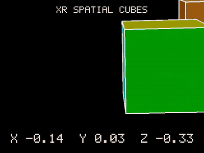

# rayneo-x3-spatial-sdk

**Unofficial** head 6DoF tracking and world-locked rendering for **RayNeo X3 Pro** AR glasses, for plain
Android apps written in Kotlin/Java and C++, **without Unity**.

> This project is not affiliated with, endorsed by or supported by RayNeo or TCL. "RayNeo" and "X3 Pro"
> are names of their owners, used only to say which device this works with. The project does not contain
> or redistribute any RayNeo software: you download the RayNeo SDK yourself (see below).

The RayNeo X3 Pro ships an OpenXR runtime with 6DoF head tracking (SLAM). RayNeo documents it for Unity.
This library talks to the same runtime directly: it binds the runtime with the two Android libraries from
the RayNeo SDK, then runs a standard OpenXR session with its own frame loop and gives your app

- the head pose (position + orientation) every frame, as raw OpenXR values with their location flags;
- a quality verdict per pose (the runtime emits stale and broken poses at the start of every session);
- per-eye view and projection matrices, so you can draw world-locked content with OpenGL ES 3;
- an optional head-locked debug text line;
- a scene API (`xrspatial-scene`): world-locked cards, images and text from ordinary Android Views, with no
  OpenGL, C++ or Activity lifecycle code in your app.



The sample app on the glasses, left eye, 14 s ([MP4](docs/media/cubes-demo.mp4)): the wearer steps
sideways and forward; the cubes stay in place, the side face comes into view and the far cube shifts
behind the near one. The bottom line is the raw head position in metres. Recorded from a computer with
`adb shell screenrecord`; the glasses are see-through, so the room is not in the picture.

Pick the level you need:

| You want | Use |
| --- | --- |
| Raw head poses (robotics, computer vision, logging) | `xrspatial-core` + `XrSpatialSession.start(listener)` |
| Your own OpenGL ES rendering | `xrspatial`: `XrSpatialSession` + an `XrRenderer` |
| Cards, images and text in the room | `xrspatial-scene`: `SpatialScene` + `SpatialHost` |

A world-locked card from an XML layout, 1.5 m in front of the wearer (`sample-scene`):

```kotlin
class MaintenanceActivity : Activity() {
    override fun onCreate(savedInstanceState: Bundle?) {
        super.onCreate(savedInstanceState)
        val scene = SpatialScene()
        val card = layoutInflater.inflate(R.layout.maintenance_card, null)
        scene.add(SpatialPanel(card, widthMeters = 0.32f, placement = Placement.InFrontOfUser(1.5f)))
        SpatialHost.attach(this, scene)
    }
}
```

Raw poses:

```kotlin
val session = XrSpatialSession(activity, surfaceView)
session.start(object : PoseListener {
    override fun onSample(sample: PoseSample, quality: SampleQuality) {
        if (quality == SampleQuality.USABLE) Log.d("pose", "${sample.px} ${sample.py} ${sample.pz}")
    }
})
```

## Status

Version 0.2.0 in development, experimental. Tested on **one** RayNeo X3 Pro, OpenXR runtime
`com.rayneo.xr.runtime` 1.1.7.9, RayNeo SDK 1.1.2. The scene API (`xrspatial-scene`, `sample-scene`) is
new in 0.2 and so far tested on the host only (layout against the device's measured eye views); it has
not run on the glasses yet. See [CHANGELOG.md](CHANGELOG.md).

| Verified on that device | Not verified |
| --- | --- |
| Session start, frame loop at 60 Hz, all four location flags reported | Metric scale (no measured translation test yet) |
| World-locked cubes stay in place during 60 s of walking and looking around (observed by the wearer) | Accuracy, drift, latency figures |
| Stable start: nothing is drawn until the start-up garbage is over | Usable timestamps (see runtime notes: XrTime is constant) |
| Eye-height marker lines up with the wearer's real eye height | Other firmware/runtime versions |
| A second session in the same process (after a focus loss) starts and tracks | |

Known issues seen on that device: after a ~90° head turn to the left the position once jumped by ~0.4 m
and kept a ~0.3 m offset (2 of 2 tries); one ~1 m position jump in another 30 s run; the location flags
read 15 even when the cameras are covered. Read [docs/x3-pro-runtime-notes.md](docs/x3-pro-runtime-notes.md)
before you rely on any of it: the runtime deviates from the OpenXR specification in a few places and the
library works around them openly.

## Requirements

- RayNeo X3 Pro with its OpenXR runtime (`com.rayneo.xr.runtime`, preinstalled; tested with 1.1.7.9).
- The RayNeo SDK 1.1.2 Android libraries `RayNeoSDK-client.aar` and `RayNeoOpenXRLoader.aar` (below).
- Android Studio / Gradle 8.11, Android Gradle Plugin 8.9, Kotlin 2.2, JDK 17.
- Android SDK 35, NDK 27.0.12077973, CMake 3.22.1. Apps: `minSdk 30`, `arm64-v8a` only.

## Get the RayNeo SDK libraries

The RayNeo libraries are not part of this repository and must not be committed to it: their package
licence ("OpenXR RAYNEO") grants no redistribution.

1. Download the **RayNeo OpenXR ARDK 1.1.2** package from RayNeo's developer documentation
   (<https://rayneo-en.gitbook.io/rayneo-devdoc/x-series/unity-sdk/ardk-download>). It is published as a
   Unity package, but only two Android libraries from it are used; no Unity is installed or needed.
2. From `OXR/Runtime/Plugins/Android/` in the package copy `RayNeoSDK-client.aar` and
   `RayNeoOpenXRLoader.aar` into `vendor/rayneo-sdk-1.1.2/` of this repository.
3. The build checks their SHA-256 and stops on any other file; see [vendor/README.md](vendor/README.md).

## Build and run the sample

```bash
./gradlew :sample:assembleDebug
```

```bash
adb install -r sample/build/outputs/apk/debug/sample-debug.apk
```

The scene sample (a maintenance card from an XML layout):

```bash
./gradlew :sample-scene:assembleDebug
```

```bash
adb install -r sample-scene/build/outputs/apk/debug/sample-scene-debug.apk
```

Put on the glasses and open **XR Spatial Cubes**. After about a second (the warm-up, "WAITING FOR
TRACKING") two cubes and a white bar appear in front of you: a 20 cm cube 1.5 m ahead, an orange cube
further away to the right, and a bar 2 m ahead at your eye height. Walk around the cubes, squat, turn
away and back: they should stay where they are. The bottom line shows the raw head position in metres.

Library and unit tests:

```bash
./gradlew :xrspatial-core:test :xrspatial:testDebugUnitTest :xrspatial-scene:testDebugUnitTest :sample:testDebugUnitTest :xrspatial:lintDebug :xrspatial-scene:lintDebug
```

Native host tests of the frame loop and render maths (any C++17 compiler, no device):

```bash
python tools/run_native_tests.py
```

## Use it in your app

There is no Maven artifact yet. Add this repository to your project (for example as a git submodule) and
include its library modules in your `settings.gradle.kts` (leave out `xrspatial-scene` if you draw yourself):

```kotlin
include(":xrspatial-core", ":xrspatial", ":xrspatial-scene")
project(":xrspatial-core").projectDir = file("rayneo-x3-spatial-sdk/xrspatial-core")
project(":xrspatial").projectDir = file("rayneo-x3-spatial-sdk/xrspatial")
project(":xrspatial-scene").projectDir = file("rayneo-x3-spatial-sdk/xrspatial-scene")
```

In `gradle.properties` point `rayneoSdkDir` at your copy of the RayNeo libraries (relative to your root
project), for example `rayneoSdkDir=rayneo-x3-spatial-sdk/vendor/rayneo-sdk-1.1.2`. Then in the app module:

```kotlin
android {
    defaultConfig { minSdk = 30; ndk { abiFilters += "arm64-v8a" } }
    // The RayNeo SDK loads its native libraries from nativeLibraryDir, so they must be extracted.
    packaging { jniLibs.useLegacyPackaging = true }
}
dependencies {
    implementation(project(":xrspatial-scene"))  // or ":xrspatial" for your own renderer
    // Your copy of the RayNeo libraries: the app packages them, this library only compiles against them.
    val rayneo = rootProject.file(providers.gradleProperty("rayneoSdkDir").get())
    implementation(files(rayneo.resolve("RayNeoSDK-client.aar"), rayneo.resolve("RayNeoOpenXRLoader.aar")))
}
```

The library's manifest adds the `queries` entry for the runtime, the two OpenXR permissions and the
`com.rayneo.mercury.app` marker the glasses' launcher looks for.

With `xrspatial-scene`, `SpatialHost.attach(activity, scene)` does the rest; see
[docs/scene.md](docs/scene.md). Without it, the Activity owns a `SurfaceView` and starts the session once
it is resumed, focused and the surface exists; stop it in `onPause`. See [CubesActivity.kt](sample/src/main/kotlin/io/github/alexskuznetsov/xrspatial/sample/CubesActivity.kt)
for the complete pattern, [CubeSceneRenderer.kt](sample/src/main/kotlin/io/github/alexskuznetsov/xrspatial/sample/CubeSceneRenderer.kt)
for a renderer, and [docs/api.md](docs/api.md) for the API.

```kotlin
class MyRenderer : XrRenderer {
    override fun onGlReady() { /* create shaders and buffers */ }
    override fun onDrawEye(eye: EyeFrame) {
        Matrix.multiplyMM(mvp, 0, eye.projection, 0, eye.view, 0)
        // draw content placed in LOCAL coordinates (metres; -Z is ahead of where you looked at start)
    }
    override fun onGlRelease() { /* delete them */ }
}
```

If another window takes focus (for example the system screen recorder), the runtime ends the session;
the library pauses (`TrackingState.PAUSED`) and starts a new session when focus returns. Content then
re-anchors to the new LOCAL space. The on-glasses screen recorder cannot record a running session.

Pose only, without drawing: call `session.start(listener)` without a renderer. The library still submits
a (black, i.e. transparent) frame every display period, as the runtime requires.

## How it works

```
Activity (main thread)                 render thread "xrspatial-render"
 FxrApi.initAndroid / bindService  -->  xrInitializeLoaderKHR, xrCreateInstance (+ Android create info)
 setWindowFocus / setSurface            EGL context on the SurfaceView, xrCreateSession (GLES binding)
 System.loadLibrary("openxr_loader")    loop: xrWaitFrame -> xrBeginFrame
                                              xrLocateSpace(VIEW, LOCAL)   -> PoseListener + WarmupGate
                                              xrLocateViews                -> EyeFrame matrices
                                              per eye: acquire swapchain image, XrRenderer.onDrawEye
                                              xrEndFrame with one projection layer
```

The RayNeo SDK part is the documented bootstrap from the RayNeo samples (bind the runtime service, hand it
the window). The native part uses only standard OpenXR 1.0 calls, resolved from the RayNeo loader that the RayNeo SDK
has loaded (`dlsym` + `xrGetInstanceProcAddr`); the standard Khronos loader cannot find this runtime.

## Repository layout

| Path | Contents |
| --- | --- |
| `xrspatial-core/` | Pure Kotlin: `PoseSample`, `SpatialTracking`, `PoseListener`, `SpatialError`, `WarmupGate`, `Vector3`, `Quaternion`, `Pose3` |
| `xrspatial/` | Android library: `XrSpatialSession`, `XrRenderer`, `EyeFrame`; C++ OpenXR frame loop (`src/main/cpp`) |
| `xrspatial-scene/` | Android library: `SpatialScene`, `SpatialHost`, `SpatialPanel`, `SpatialImage`, `SpatialText`, `Placement` (Kotlin + GLES, no native code) |
| `sample/` | World-locked cubes app (own `XrRenderer`) |
| `sample-scene/` | Maintenance card from an XML layout (`xrspatial-scene`) |
| `tests/native/` | Host tests of the C++ headers against a fake OpenXR runtime |
| `third_party/openxr/` | Khronos OpenXR 1.1.63 headers |
| `vendor/` | Where you put the RayNeo libraries (ignored by git) |
| `docs/` | API reference and device notes |

## Roadmap

| Version | Content |
| --- | --- |
| 0.2 | Scene API: panels from Android Views, text, images, session-local placement (this version) |
| 0.3 | Jetpack Compose content in panels (Compose rendered into a texture through a virtual display) |
| 0.4 | Input (gaze ray, touchpad, possibly hand tracking, which the runtime advertises), pose-trace recording and replay for tests without the glasses |
| later | Spatial anchors or OpenXR spatial containers (`XR_EXT_spatial_container`) only if the RayNeo runtime starts to advertise them; `diagnostics()["extensions"]` shows what it offers |

## Licence

Apache License 2.0, see [LICENSE](LICENSE) and [NOTICE](NOTICE). Third-party parts are listed in
[THIRD_PARTY_NOTICES.md](THIRD_PARTY_NOTICES.md). The RayNeo SDK you download is under RayNeo's own terms.
