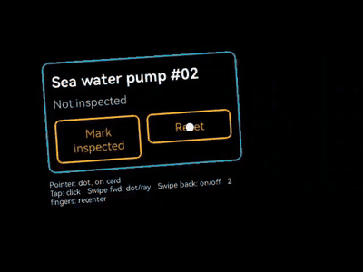

# RayNeo X3 Spatial SDK

Build spatial Android apps for **RayNeo X3 Pro** AR glasses in plain Kotlin: head 6DoF tracking and
world-locked content, **no Unity**.

Unofficial · Apache-2.0 · v0.3, experimental

> Not affiliated with, endorsed by or supported by RayNeo or TCL. This repository contains no RayNeo
> software; you download the RayNeo SDK yourself ([how](#2-get-the-rayneo-libraries)).


*The cube sample on the glasses (left eye): the wearer steps sideways and forward, the cubes stay in place.
Recorded with `adb shell screenrecord`; the glasses are see-through, so the room is not in the picture.*

## What you get

The X3 Pro runs an OpenXR runtime with 6DoF tracking (SLAM) that RayNeo documents only for Unity. This
SDK talks to that runtime directly and gives you three levels to choose from:

| You want | Module | Main classes |
| --- | --- | --- |
| Cards, images and text in the room | `xrspatial-scene` | `SpatialScene`, `SpatialHost`, `SpatialPanel` |
| Your own OpenGL ES rendering | `xrspatial` | `XrSpatialSession`, `XrRenderer` |
| Raw head poses (robotics, vision, logging) | `xrspatial-core` | `PoseSample`, `WarmupGate` |

A card from an ordinary XML layout, fixed in the room 1.5 m in front of the wearer:

```kotlin
class MaintenanceActivity : Activity() {
    override fun onCreate(savedInstanceState: Bundle?) {
        super.onCreate(savedInstanceState)
        val scene = SpatialScene()
        val card = layoutInflater.inflate(R.layout.maintenance_card, null)
        scene.add(SpatialPanel(card, widthMeters = 0.32f, placement = Placement.InFrontOfUser(1.5f)))
        SpatialHost.attach(this, scene)
    }
}
```

No OpenGL, C++ or lifecycle code: `SpatialHost` runs the tracking session with the Activity.

### Pointer: see what you aim at, click with the touchpad



*The pointer sample on the glasses (left eye): the dot sits on the button the wearer looks at, a tap on the
temple touchpad clicks it ("Inspected ✓" / "Not inspected"); a swipe switches to the ray.*

The scene draws a **dot** or a **ray** from the centre of the view and tells you what it points at. What a tap
means stays in your app: the temple touchpad arrives as ordinary Android touch events.

```kotlin
class PointerActivity : Activity() {
    private val scene = SpatialScene()
    private val pointer = SpatialPointer(PointerStyle.Dot())          // or PointerStyle.Ray()
    private lateinit var card: SpatialPanel

    override fun onCreate(savedInstanceState: Bundle?) {
        super.onCreate(savedInstanceState)
        val view = layoutInflater.inflate(R.layout.pointer_card, null)
        view.findViewById<View>(R.id.inspect).setOnClickListener { /* an ordinary click listener */ }
        card = scene.add(SpatialPanel(view, widthMeters = 0.34f, placement = Placement.InFrontOfUser(1.5f)))
        scene.pointer = pointer
        SpatialHost.attach(this, scene)
    }

    // A short touch on the temple touchpad clicks the view under the pointer.
    override fun dispatchTouchEvent(e: MotionEvent): Boolean {
        if (e.actionMasked == MotionEvent.ACTION_UP && e.eventTime - e.downTime < 300)
            pointer.hit?.let { card.performClickAt(it) }
        return true
    }
}
```

Everything can be changed at any time, from any thread:

```kotlin
pointer.enabled = false                                // hide it (and stop hit reports); true shows it again
pointer.style = PointerStyle.Ray()                     // dot <-> ray
pointer.source = PointerSource.Custom { myPose() }     // a pose from your own tracking instead of the gaze
pointer.listener = PointerListener { hit -> /* main thread: target changed, or null */ }
val hit = pointer.hit                                  // node, point, distance, u/v and pixel on the panel
scene.pointer = null                                   // remove it
```

Details: [docs/scene.md#pointer](docs/scene.md#pointer). The full sample with taps, swipes and two-finger tap is
[`sample-pointer`](sample-pointer).

## Samples

| Module | Launcher name | Shows |
| --- | --- | --- |
| [`sample-scene`](sample-scene) | XR Spatial Card | A card from an XML layout, world-locked |
| [`sample-pointer`](sample-pointer) | XR Spatial Pointer | Dot / ray pointer, clicks from the touchpad, pointer on/off |
| [`sample`](sample) | XR Spatial Cubes | Own OpenGL ES renderer with world-locked cubes |
| [`sample-input`](sample-input) | XR Spatial Input Probe | Logs every input event during an XR session (diagnostics) |

## Getting started

### 1. Requirements

- RayNeo X3 Pro (tested with OpenXR runtime 1.1.7.9)
- JDK 17, Android SDK 35, NDK 27.0.12077973, CMake 3.22.1
- Apps: `minSdk 30`, `arm64-v8a`

### 2. Get the RayNeo libraries

1. Download **RayNeo OpenXR ARDK 1.1.2** from
   [RayNeo's developer site](https://rayneo-en.gitbook.io/rayneo-devdoc/x-series/unity-sdk/ardk-download).
   It is a Unity package, but only two Android libraries are taken from it; Unity is not needed.
2. Copy `RayNeoSDK-client.aar` and `RayNeoOpenXRLoader.aar` from `OXR/Runtime/Plugins/Android/` into
   `vendor/rayneo-sdk-1.1.2/`.

The build checks their checksums ([vendor/README.md](vendor/README.md)). Never commit them: RayNeo's
licence does not allow redistribution.

### 3. Run the card sample

```bash
./gradlew :sample-scene:assembleDebug
```

```bash
adb install -r sample-scene/build/outputs/apk/debug/sample-scene-debug.apk
```

Open **XR Spatial Card** on the glasses. After about a second the card appears in front of you; walk
around and it stays in place. The other samples build the same way (`:sample-pointer`, `:sample`).

### 4. Use it in your app

Include the modules from this repository and add the RayNeo libraries to your app:
[docs/integration.md](docs/integration.md).

## Status

Tested on one X3 Pro (runtime 1.1.7.9, RayNeo SDK 1.1.2):

- **Works:** tracking at 60 Hz; world-locked cubes and cards stay in place while walking and turning;
  stable start (nothing is drawn during the runtime's ~1 s of start-up garbage); pause and resume when
  another app takes focus; cards are centred, readable and correctly coloured; a dot or ray pointer shows
  what the wearer aims at, and taps on the temple touchpad click the button under it.
- **Not measured yet:** metric scale, accuracy and drift, latency; other firmware versions.
- **Known issues:** position jumps were seen (~0.3–0.4 m after a ~90° head turn; once ~1 m in a 30 s run;
  `TrackingConfidence.DEGRADED` marks them); the runtime's timestamps and tracking flags are not usable;
  `XR_EXT_hand_tracking` is advertised but crashes the runtime, so hand tracking stays off; a long press on the
  touchpad opens a system app (see the runtime notes).

## Documentation

| Document | Contents |
| --- | --- |
| [docs/scene.md](docs/scene.md) | Scene API: panels, text, images, placement, designing for this display |
| [docs/api.md](docs/api.md) | Session, renderer, poses, quality gate, errors, lifecycle |
| [docs/integration.md](docs/integration.md) | Adding the SDK to an app; your own renderer |
| [docs/x3-pro-runtime-notes.md](docs/x3-pro-runtime-notes.md) | How the X3 Pro runtime deviates from OpenXR, and what the SDK does about it |
| [docs/architecture.md](docs/architecture.md) | How it works, repository layout |
| [CONTRIBUTING.md](CONTRIBUTING.md) | Building, tests |
| [CHANGELOG.md](CHANGELOG.md) | Versions |

## Roadmap

- **0.3** (done): pointer API (dot / ray), touchpad facts, lifecycle hardening, tracking confidence
- **0.4**: Jetpack Compose content in panels; cheaper panel updates (reused buffers)
- **0.5**: recorded pose traces for testing without the glasses
- **Later**: spatial anchors or OpenXR spatial containers, if the RayNeo runtime starts to support them

## Licence

Apache License 2.0 ([LICENSE](LICENSE), [NOTICE](NOTICE), [third-party notices](THIRD_PARTY_NOTICES.md)).
The RayNeo SDK is under RayNeo's own terms.
